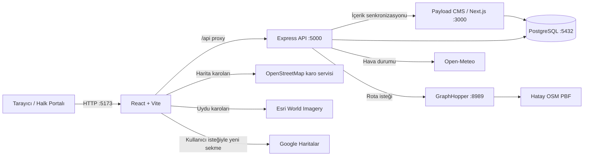
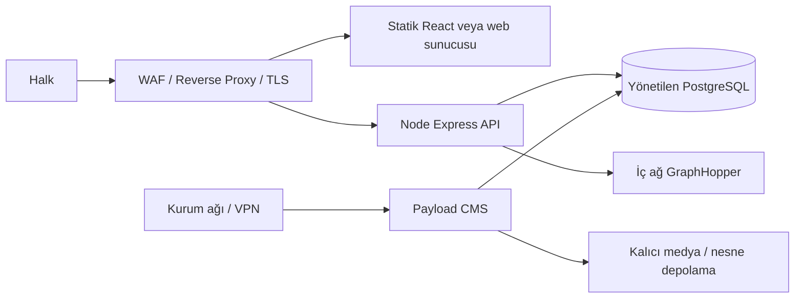

# TKMBS Ayrıntılı Proje ve Devir-Teslim Raporu

> **Proje:** Hatay Büyükşehir Belediyesi Tarihi ve Kültürel Miras Bilgi Sistemi (TKMBS)<br>
> **Belge türü:** Teknik mimari, kurulum, işletim ve devir-teslim dokümanı<br>
> **Son güncelleme:** 2 Eylül 2026<br>
> **Ana depo:** `belediye-tarih-ve-k-lt-r`<br>
> **Belgenin durumu:** Projenin mevcut koduyla birlikte kullanılacak ana teknik referans

Bu belge, projeyi teslim alan geliştirici veya kurum personelinin sistemi başka bir açıklamaya ihtiyaç duymadan kurabilmesi, çalıştırabilmesi, bileşenleri anlayabilmesi ve gerçek belediye verilerine uyarlayabilmesi için hazırlanmıştır. Belgede gizli anahtar, gerçek parola veya kişisel veri bulunmaz.

---

<a id="icindekiler"></a>
## İçindekiler

1. [Belgenin kullanım amacı](#1-belgenin-kullanim-amaci)
2. [Projenin kısa özeti](#2-projenin-kisa-ozeti)
3. [Mimari genel görünüm](#3-mimari-genel-gorunum)
4. [Teknoloji bileşenleri](#4-teknoloji-bilesenleri)
5. [Servisler, adresler ve zorunluluk durumu](#5-servisler-adresler-ve-zorunluluk-durumu)
6. [Proje klasör yapısı](#6-proje-klasor-yapisi)
7. [Halk portalı ve sayfalar](#7-halk-portali-ve-sayfalar)
8. [Frontend veri erişim katmanı](#8-frontend-veri-erisim-katmani)
9. [Express API ve uç noktalar](#9-express-api-ve-uc-noktalar)
10. [Payload CMS içerik yönetimi](#10-payload-cms-icerik-yonetimi)
11. [PostgreSQL veri modeli](#11-postgresql-veri-modeli)
12. [Kimlik doğrulama, token ve iki adımlı doğrulama](#12-kimlik-dogrulama-token-ve-iki-adimli-dogrulama)
13. [Rol ve yetki matrisi](#13-rol-ve-yetki-matrisi)
14. [OpenLayers, GeoJSON ve harita yapısı](#14-openlayers-geojson-ve-harita-yapisi)
15. [Rota motoru ve Google Haritalar aktarımı](#15-rota-motoru-ve-google-haritalar-aktarimi)
16. [Hava durumu, görseller ve dış servisler](#16-hava-durumu-gorseller-ve-dis-servisler)
17. [Raporlama ve analitik](#17-raporlama-ve-analitik)
18. [Örnek veriler ve gerçek veriye geçiş](#18-ornek-veriler-ve-gercek-veriye-gecis)
19. [Ortam değişkenleri](#19-ortam-degiskenleri)
20. [Sıfırdan kurulum](#20-sifirdan-kurulum)
21. [Günlük çalıştırma ve kapatma](#21-gunluk-calistirma-ve-kapatma)
22. [Veritabanı migration, seed ve medya aktarımı](#22-veritabani-migration-seed-ve-medya-aktarimi)
23. [Test, lint ve derleme](#23-test-lint-ve-derleme)
24. [Güvenlik mimarisi](#24-guvenlik-mimarisi)
25. [Çevrimdışı çalışma ve bağımlılık matrisi](#25-cevrimdisi-calisma-ve-bagimlilik-matrisi)
26. [Canlı ortama kurulum yaklaşımı](#26-canli-ortama-kurulum-yaklasimi)
27. [Yedekleme ve geri yükleme](#27-yedekleme-ve-geri-yukleme)
28. [Sorun giderme](#28-sorun-giderme)
29. [Bilinen sınırlamalar ve dikkat edilmesi gerekenler](#29-bilinen-sinirlamalar-ve-dikkat-edilmesi-gerekenler)
30. [Bakım ve geliştirme rehberi](#30-bakim-ve-gelistirme-rehberi)
31. [Teslim kontrol listesi](#31-teslim-kontrol-listesi)
32. [Önemli dosyalar dizini](#32-onemli-dosyalar-dizini)
33. [Terimler sözlüğü](#33-terimler-sozlugu)

---

<a id="1-belgenin-kullanim-amaci"></a>
## 1. Belgenin kullanım amacı

Bu rapor aşağıdaki soruların tamamına cevap vermeyi amaçlar:

- Projede hangi teknolojiler neden kullanıldı?
- Frontend, backend, CMS, PostgreSQL ve rota motoru birbirine nasıl bağlanıyor?
- Hangi servis çalışmazsa hangi özellik durur?
- Proje hangi dizinden, hangi komutlarla başlatılır ve kapatılır?
- İçerikler nerede saklanır ve Payload üzerinden nasıl yönetilir?
- Kullanıcı, favori, bildirim ve kişisel rota bilgileri nerede tutulur?
- Harita neden OpenLayers kullanır ve GeoJSON sözleşmesi nasıldır?
- Rota çizgisi hangi servis tarafından oluşturulur?
- Gerçek belediye CBS verileri geldiğinde hangi katman değiştirilmelidir?
- Token süreleri, roller ve Google Authenticator doğrulaması nasıl işler?
- Sunum verileri ile gerçek veriler birbirine karışmadan nasıl değiştirilir?
- Canlı kurulumdan önce hangi güvenlik ve işletim adımları tamamlanmalıdır?

> [İçindekilere dön](#icindekiler)

---

<a id="2-projenin-kisa-ozeti"></a>
## 2. Projenin kısa özeti

TKMBS; Hatay'ın tarihi eserlerini, kültürel rotalarını ve etkinliklerini halka sunan, harita tabanlı bir web portalıdır. İçerikler Payload CMS üzerinden yönetilir ve PostgreSQL'de saklanır. Halk portalı React ile hazırlanmıştır. Harita görüntüleme ve GeoJSON işleme OpenLayers ile yapılır. Araç rotaları yerel GraphHopper servisi üzerinden OpenStreetMap yol ağı kullanılarak hesaplanabilir.

Sistem üç temel kullanıcı grubuna sahiptir:

- **Ziyaretçi:** Giriş yapmadan eser, rota, etkinlik, harita, arama ve hakkında sayfalarını kullanır.
- **Vatandaş (`citizen`):** Kayıt olur; favorilerini, bildirimlerini ve kişisel rotalarını yönetir.
- **İçerik yöneticisi (`editor` / `admin`):** Portal giriş ekranından parola ve Google Authenticator doğrulaması yaparak Payload CMS'e yönlendirilir.

Mevcut örnek içerik hacmi:

| İçerik türü | Örnek kayıt sayısı |
|---|---:|
| Tarihi eser | 20 |
| Kültürel rota | 20 |
| Etkinlik | 20 |
| Bildirim | 8 |

Bu kayıtlar sunum ve geliştirme içindir. Uygulama sayfalama, filtreleme ve ilişkisel veri yapısıyla daha büyük veri kümelerine hazırlanmıştır; gerçek kapasite sunucu, PostgreSQL kaynakları, indeksler, medya depolaması ve yük testi sonucuna göre belirlenmelidir.

> [İçindekilere dön](#icindekiler)

---

<a id="3-mimari-genel-gorunum"></a>
## 3. Mimari genel görünüm



### 3.1 Veri akışı

1. Kullanıcı `http://localhost:5173` üzerinden React portalını açar.
2. Vite geliştirme sunucusu `/api` isteklerini `http://localhost:5000` adresindeki Express API'ye yönlendirir.
3. Express içerik isteklerinde Payload CMS ile bağlantıyı doğrular ve yayımlanmış verileri alır.
4. Payload içerikleri ve yönetici hesapları PostgreSQL'de tutulur.
5. Portal vatandaş hesapları, refresh oturumları, favoriler, bildirim okuma durumları, kişisel rotalar ve anonim analitik olayları aynı PostgreSQL veritabanındaki `tkmbs_*` tablolarında tutulur.
6. Rota önizlemesi istendiğinde Express, GraphHopper veya yapılandırılmış alternatif sağlayıcıdan yol geometrisi ister.
7. Express verileri frontend'in beklediği DTO ve GeoJSON biçimine dönüştürür.
8. OpenLayers, `EPSG:4326` koordinatlarını kendi görünüm izdüşümü olan `EPSG:3857` biçimine çevirerek gösterir.

### 3.2 Neden bu ayrım kullanıldı?

- React yalnızca kullanıcı arayüzü ve etkileşimlerden sorumludur.
- Express tek bir portal API sözleşmesi sağlar; frontend'i Payload ve rota sağlayıcısının ayrıntılarından ayırır.
- Payload içerik ekleme, taslak, yayınlama, medya ve yönetici ekranlarını hazır ve denetlenebilir biçimde sağlar.
- PostgreSQL kalıcı, ilişkisel ve gerçek belediye verisine uygun bir veri katmanı sağlar.
- OpenLayers belediyenin istediği kütüphanedir ve GeoJSON/CBS entegrasyonuna uygundur.
- GraphHopper yol geometrisini harita gösteriminden ayırır; OpenLayers rota hesaplamaz, yalnızca sonucu çizer.

> [İçindekilere dön](#icindekiler)

---

<a id="4-teknoloji-bilesenleri"></a>
## 4. Teknoloji bileşenleri

| Katman | Teknoloji | Görevi |
|---|---|---|
| Halk arayüzü | React 18 | Sayfalar, kartlar, filtreler, profil ve kullanıcı etkileşimi |
| İstemci yönlendirme | React Router 7 | Sayfa URL'leri, detay slug'ları ve korumalı rotalar |
| Frontend derleme | Vite 8 | Geliştirme sunucusu, API proxy ve production paketi |
| Harita | OpenLayers 9 | OSM/uydu katmanı, GeoJSON, semboller, kümeler, rota ve koordinatlar |
| Portal API | Node.js + Express 4 | DTO, içerik birleştirme, kimlik, kullanıcı işlemleri ve rota sağlayıcısı |
| Güvenlik başlıkları | Helmet | HTTP güvenlik başlıkları ve framework bilgisinin gizlenmesi |
| İçerik yönetimi | Payload CMS 3.88 | Eser, rota, etkinlik, bildirim, medya ve portal ayarları |
| CMS çalışma çatısı | Next.js 16 | Payload yönetim arayüzü ve özel yönetim görünümleri |
| Veritabanı | PostgreSQL 16 | İçerik, kullanıcı, oturum, favori, analitik ve kişisel rota verileri |
| Rota motoru | GraphHopper 11 | OpenStreetMap yol ağı üzerinde araç güzergâhı |
| CBS veri biçimi | GeoJSON | Nokta ve LineString geometrilerinin ortak sözleşmesi |
| Görsel işleme | Sharp | Payload medya boyutlandırma ve küçük resim üretimi |
| 2FA | TOTP / Google Authenticator | Yönetici ve editör için ikinci doğrulama adımı |
| QR üretimi | `qrcode` | İlk TOTP kurulumunda QR kodu üretimi |
| PDF rapor | PDFKit | Payload rapor ekranından PDF dışa aktarma |
| Konteyner | Docker Compose | Yerel PostgreSQL ve GraphHopper servislerini çalıştırma |
| Test | Node Test Runner, Vitest, Playwright | Veri, rota, CMS entegrasyon ve uçtan uca testleri |

### 4.1 Önerilen çalışma ortamı

- Windows 10/11 veya güncel Linux dağıtımı
- Node.js 20.19+ veya güncel LTS sürümü
- npm 10+
- Docker Desktop / Docker Engine ve Compose v2
- Güncel Chrome, Edge veya Firefox
- En az 8 GB RAM; GraphHopper için tercihen 16 GB
- GraphHopper ilk veri içe aktarımı için yeterli boş disk alanı

> **Not:** Kök `package.json` içinde tarihsel olarak daha düşük Node sürümü yazsa da Vite 8 ve Next.js 16 nedeniyle teslim ortamında Node.js 20.19+ kullanılmalıdır.

> [İçindekilere dön](#icindekiler)

---

<a id="5-servisler-adresler-ve-zorunluluk-durumu"></a>
## 5. Servisler, adresler ve zorunluluk durumu

| Servis | Varsayılan adres | Zorunlu mu? | Olmadan ne olur? |
|---|---|---|---|
| React/Vite portalı | `http://localhost:5173` | Evet | Halk arayüzü açılmaz. |
| Express API | `http://localhost:5000` | Evet | Portal veri, giriş, favori, bildirim ve rota API'lerine ulaşamaz. |
| Payload CMS | `http://localhost:3000/admin` | Evet | İçerik yönetilemez; Express içerik isteklerini güvenli biçimde `503` ile reddeder. |
| PostgreSQL | `127.0.0.1:5432` | Evet | CMS ve kalıcı kullanıcı işlemleri çalışmaz; API varsayılan olarak demo belleğe düşmez. |
| GraphHopper | `http://localhost:8989` | Rota için gerekli | Eser/etkinlik sayfaları açılır; yol geometrisi oluşturulamaz ve kuş uçuşu yanıltıcı çizgi üretilmez. |
| Open-Meteo | İnternet üzerinden | Hayır | Son başarılı önbellek veya yerel örnek hava verisi gösterilir. |
| OSM karo servisi | İnternet üzerinden | Standart harita için | İşaretçiler/veriler hazır olsa bile standart temel harita karoları görünmez. |
| Esri World Imagery | İnternet üzerinden | Uydu görünümü için | Uydu görünümü açılmaz; standart OSM kullanılabilir. |
| Google Haritalar | Yeni tarayıcı sekmesi | Hayır | Yalnızca “Google Haritalar'da Aç” özelliği kullanılamaz. |

### 5.1 Docker zorunlu mu?

Docker uygulama kodu için mutlak zorunluluk değildir. Aşağıdaki servisler Docker dışında da kurulabilir:

- PostgreSQL bilgisayara doğrudan kurulup `DATABASE_URL` buna göre verilebilir.
- GraphHopper Java ile doğrudan çalıştırılabilir veya kurumun rota servisi kullanılabilir.

Mevcut proje, taşınabilir ve tekrarlanabilir geliştirme ortamı için Docker Compose dosyaları sunar. Belediye ortamında kurumun mevcut PostgreSQL veya konteyner altyapısı tercih edilebilir.

> [İçindekilere dön](#icindekiler)

---

<a id="6-proje-klasor-yapisi"></a>
## 6. Proje klasör yapısı

```text
belediye-portal/
├── backend-server.js                 Express API giriş noktası
├── package.json                      Kök komutlar ve frontend/backend bağımlılıkları
├── vite.config.js                    Vite ve /api proxy ayarı
├── .env.example                      Portal/backend örnek ortam ayarları
├── DETAYLI_PROJE_RAPORU.md           Bu devir-teslim belgesi
├── src/                              React halk portalı
│   ├── App.jsx                       Sayfa yönlendirmeleri ve analitik izleyici
│   ├── auth/                         React oturum bağlamı ve rota koruması
│   ├── components/
│   │   ├── common/                   Ortak ikon, güvenli görsel ve Google butonu
│   │   ├── layout/                   Header, sidebar, footer ve genel yerleşim
│   │   └── map/                      OpenLayers haritası ve kategori işaretçileri
│   ├── hooks/                        Sürükleyerek kaydırma ve favori kimlikleri
│   ├── pages/                        Portal sayfaları ve stilleri
│   ├── services/                     API, retry ve kimlik istemcileri
│   ├── styles/                       Ortak okunabilirlik ve yerleşim CSS'i
│   └── utils/                        Google Haritalar URL yardımcısı
├── backend/
│   ├── analytics/                    Anonim sayfa görüntüleme doğrulaması
│   ├── auth/                         Token, parola, TOTP, DTO ve repository
│   ├── data/                         Örnek içerik, dönüştürücüler ve testler
│   ├── security/                     İstek hız sınırı
│   └── services/
│       ├── cbs/                      Gerçek CBS sağlayıcı sözleşmesi için adaptör
│       ├── cms/                      Payload okuma, dönüştürme ve önbellek
│       └── routing/                  GraphHopper/OSRM ve rota önizlemesi
├── cms/
│   ├── src/collections/              Payload koleksiyonları
│   ├── src/globals/                  Portal genel ayarları
│   ├── src/components/               Rapor ve kullanıcı yönetimi ekranları
│   ├── src/app/(payload)/api/        Özel Payload API uç noktaları
│   ├── src/migrations/               PostgreSQL/Payload migration dosyaları
│   ├── src/reporting/                Rapor filtre yardımcıları
│   ├── src/scripts/                  Medya geçiş komutları
│   ├── src/seed.ts                   Örnek içerik aktarımı
│   ├── payload.config.ts             Payload ana yapılandırması
│   ├── next.config.ts                Next.js yapılandırması
│   ├── docker-compose.yml            Yerel PostgreSQL
│   └── .env.example                  CMS ortam ayarları
├── routing/
│   ├── Dockerfile                    GraphHopper 11 imajı
│   ├── docker-compose.yml            GraphHopper servisi
│   ├── config.yml                    Araç profili ve grafik ayarları
│   └── data/hatay.osm.pbf            Git dışında tutulan OSM yol verisi
└── public/assets/                     Portalın yerel örnek görselleri
```

### 6.1 Git'e eklenmeyen dosyalar

Aşağıdakiler `.gitignore` ile depoya gönderilmez:

- `.env` ve `cms/.env`: parola ve gizli anahtarlar
- `node_modules/`, `cms/node_modules/`: yeniden kurulabilir bağımlılıklar
- `dist/`, `cms/.next/`: derleme çıktıları
- `cms/media/`: yerel yüklenen medya dosyaları
- `routing/data/`: büyük OSM PBF dosyaları
- `routing/graph-cache/`: yeniden üretilebilir rota grafiği
- test çıktıları, loglar ve IDE ayarları

> [İçindekilere dön](#icindekiler)

---

<a id="7-halk-portali-ve-sayfalar"></a>
## 7. Halk portalı ve sayfalar

Aktif yönlendirmeler `src/App.jsx` dosyasındadır.

| URL | Bileşen | Giriş | Açıklama |
|---|---|---|---|
| `/` | `HomePage` | Gerekmez | Kayan tanıtım, öne çıkan eserler, rotalar, harita ve etkinlikler |
| `/harita` | `MapPage` | Gerekmez | Katman/filtre, koordinat, sembol ve rota durak seçimi |
| `/tarihi-eserler` | `MonumentsPage` | Gerekmez | Arama, kategori/ilçe/dönem ve favori filtresi |
| `/tarihi-eserler/:slug` | `MonumentDetailPage` | Gerekmez | Galeri, tarihçe, detay, mini harita ve yakın eserler |
| `/kultur-rotalari` | `RoutesPage` | Gerekmez | Rota listesi, filtreler ve kişisel rota çağrısı |
| `/kultur-rotalari/:slug` | `RouteDetailPage` | Gerekmez | Duraklar, yol geometrisi, harita ve favori işlemi |
| `/rota-olustur` | `RouteBuilderPage` | Görüntüleme gerekmez | Haritadan durak seçme ve yol önizleme; kaydetme vatandaş girişi ister |
| `/etkinlikler` | `EventsPage` | Gerekmez | Etkinlik listesi, filtre ve büyüyen takvim |
| `/etkinlikler/:slug` | `EventDetailPage` | Gerekmez | Etkinlik ayrıntısı, konum ve ilgili etkinlikler |
| `/profil/*` | `FavoritesPage` | `citizen` | Favoriler, profil bilgisi, geçmiş, ayarlar ve kayıtlı rotalar |
| `/favoriler` | Yönlendirme | `citizen` | `/profil` adresine yönlendirir |
| `/bildirimler` | `NotificationsPage` | `citizen` | Kullanıcıya özel okundu/okunmadı durumu |
| `/hakkinda` | `AboutPage` | Gerekmez | Payload ayarlarından gelen kurumsal ve kültürel metinler |
| `/arama` | `SearchResultsPage` | Gerekmez | Eser, rota ve etkinlik ortak araması |
| `/giris` | `LoginPage` | Gerekmez | Vatandaş veya yönetim girişi ve 2FA |
| `/kayit-ol` | `RegisterPage` | Gerekmez | Vatandaş kaydı |
| `/yetkisiz` | Basit uyarı | Duruma göre | Rol yetkisi bulunmadığında gösterilir |

### 7.1 Aktif olmayan eski yönetim bileşenleri

`AdminPanelPage`, `AdminSidebar`, `AdminModulePlaceholderPage` ve `GisAnalyticsPage` gibi eski özel yönetim paneli kaynakları silinmemiştir; ancak `src/App.jsx` içinde aktif route bağlantıları yoktur. Güncel yönetim sistemi Payload CMS'tir. Bu dosyalar gelecekte karar değişirse referans olmak üzere korunmaktadır ve mevcut teslim akışının parçası değildir.

### 7.2 Erişilebilirlik ve okunabilirlik

- Genel yazı boyutları `src/styles/readability.css` ve sayfa CSS'leriyle büyütülmüştür.
- Mobil görünüm ve sürükleyerek yatay/dikey kart kaydırma desteklenir.
- Görsellerde `SafeImage` kullanılarak eksik/kırık görsel yerine varsayılan görsel gösterilir.
- Harita sembolleri yalnızca renge dayanmaz; kategori ikonları kullanır.
- Medyada alternatif metin Payload alanı olarak zorunludur.

> [İçindekilere dön](#icindekiler)

---

<a id="8-frontend-veri-erisim-katmani"></a>
## 8. Frontend veri erişim katmanı

### 8.1 `src/services/api.js`

Bu dosya bütün içerik API çağrılarını tek sözleşmede toplar. Sayfalar doğrudan `fetch` ayrıntısına bağımlı kalmaz.

Başlıca fonksiyon grupları:

- Arama: `search`
- Eser: `getMonuments`, `getMonumentsPage`, `getMonument`
- Rota: `getRoutes`, `getRoutesPage`, `getRoute`, `previewRoute`
- Etkinlik: `getEvents`, `getEventsPage`, `getEventCalendar`, `getEvent`
- Harita: `getLocations`, `getLocation`
- İçerik: `getHomeContent`, `getAboutContent`
- Hava/istatistik: `getWeather`, `getStatistics`, `getCharts`
- Bildirim: liste, sayaç, tek/tümünü okundu yapma
- Favori: liste, sayfalı içerik ve toggle
- Kişisel rota: listeleme, getirme, kaydetme, güncelleme, silme
- Analitik: anonim sayfa görüntüleme

### 8.2 Gerçek ve örnek veri seçimi

`VITE_USE_MOCK_DB=true` yalnızca izole frontend geliştirmesinde içerik okumasını örnek veri modülüne yönlendirebilir. Aşağıdaki kullanıcıya özel işlemler mock moda düşmez ve her zaman gerçek API/PostgreSQL kullanır:

- Bildirim okuma durumu
- Favoriler
- Kişisel rotalar
- Anonim analitik olayları

Teslim ve gerçek kullanım için:

```env
VITE_USE_MOCK_DB=false
```

### 8.3 `src/services/authClient.js`

- Access token yalnızca bellek içinde tutulur.
- Refresh token JavaScript'e verilmez; HttpOnly cookie kullanılır.
- Yetki gerektiren API isteği `401` alırsa bir kez refresh denenir.
- Aynı anda birden fazla refresh isteğinin açılmasını engelleyen paylaşılan promise kullanılır.
- Yönetici/editor girişinde kısa ömürlü 2FA kanıtıyla Payload oturumu açılır.
- Vatandaş ve Payload yönetici oturumları aynı tarayıcıda birbirine karışmayacak şekilde ayrılır.

### 8.4 Retry davranışı

`src/services/apiRetry.js` ve backend Payload istemcisi geçici bağlantı hatalarında sınırlı yeniden deneme yapar. Kalıcı istemci hataları sonsuz döngüye sokulmaz.

> [İçindekilere dön](#icindekiler)

---

<a id="9-express-api-ve-uc-noktalar"></a>
## 9. Express API ve uç noktalar

Ana dosya: `backend-server.js`
Varsayılan adres: `http://127.0.0.1:5000`

Standart başarılı yanıt:

```json
{
  "success": true,
  "data": {}
}
```

Standart hata yanıtı:

```json
{
  "success": false,
  "error": "Açıklayıcı hata mesajı"
}
```

### 9.1 Kimlik doğrulama uç noktaları

| Yöntem | Yol | Yetki | Görev |
|---|---|---|---|
| POST | `/api/auth/register` | Açık | Vatandaş hesabı oluşturur |
| POST | `/api/auth/login` | Açık | Parola doğrular; vatandaş tokenı veya yönetim 2FA challenge döndürür |
| POST | `/api/auth/two-factor/verify` | Challenge | TOTP/kurtarma kodunu doğrular |
| POST | `/api/auth/refresh` | Refresh cookie | Access tokenı döndürür ve refresh tokenı yeniler |
| POST | `/api/auth/logout` | Cookie varsa | Refresh oturumunu iptal eder |
| GET | `/api/auth/me` | Access token | Güvenli kullanıcı DTO'sunu verir |

### 9.2 İçerik ve harita uç noktaları

| Yöntem | Yol | Açıklama |
|---|---|---|
| GET | `/api/search` | Eser, rota ve etkinlik ortak araması |
| GET | `/api/locations` | Filtrelenebilir GeoJSON FeatureCollection |
| GET | `/api/locations/:id` | Kimlikle konum/eser |
| GET | `/api/locations/slug/:slug` | Slug ile konum/eser |
| GET | `/api/monuments` | Eser listesi veya `page/pageSize` ile sayfalama |
| GET | `/api/monuments/:id` | Kimlik veya slug ile eser detayı |
| GET | `/api/categories` | Eser kategori sayıları |
| GET | `/api/routes` | Rota listesi; sayfalı istekte yol metrikleri zenginleştirilir |
| POST | `/api/routes/preview` | Durak kimliklerinden araç yolu önizlemesi |
| GET | `/api/routes/:id` | Rota detayı ve canlı yol geometrisi |
| GET | `/api/routes/:id/geojson` | Rotanın GeoJSON verisi |
| GET | `/api/events/calendar` | Aylık/günlük takvim verisi |
| GET | `/api/events` | Etkinlik listesi ve sayfalama |
| GET | `/api/events/:id` | Etkinlik detayı |
| GET | `/api/events/categories/counts` | Etkinlik kategori sayıları |
| GET | `/api/content/home` | Payload Portal Ayarları içindeki ana sayfa içeriği |
| GET | `/api/content/about` | Payload Portal Ayarları içindeki hakkında içeriği |
| GET | `/api/statistics` | Ana veri tablolarından özet sayılar |
| GET | `/api/charts` | Ana veri tablolarıyla uyumlu grafik verileri |
| GET | `/api/weather` | Open-Meteo Antakya hava durumu veya fallback |
| GET | `/api/health` | Repository, CMS ve rota sağlayıcı durumu |

### 9.3 Vatandaş uç noktaları

Bu uç noktalar yalnızca `citizen` access tokenı kabul eder.

| Yöntem | Yol | Görev |
|---|---|---|
| GET | `/api/user/favorites` | Türlere göre favori kimlikleri |
| GET | `/api/user/favorites/:type/items` | Favorilerin sayfalı içerikleri |
| POST | `/api/user/favorites/:type/:id/toggle` | Favori ekleme/çıkarma |
| GET | `/api/user/profile-overview` | Profil geçmişi ve özet bilgiler |
| POST | `/api/user/preferences` | İzin verilen profil tercihlerini günceller |
| GET | `/api/user/routes` | Kullanıcının kaydettiği rotalar |
| GET | `/api/user/routes/:id` | Yalnızca o kullanıcıya ait rota |
| POST | `/api/user/routes` | Kişisel rota kaydeder |
| PATCH | `/api/user/routes/:id` | Kişisel rotayı günceller |
| DELETE | `/api/user/routes/:id` | Kişisel rotayı siler |
| GET | `/api/notifications/count` | Okunmamış bildirim sayısı |
| GET | `/api/notifications` | Bildirimler ve kullanıcıya özel okundu durumu |
| POST | `/api/notifications/:id/read` | Tek bildirimi okundu yapar |
| POST | `/api/notifications/read-all` | Tüm bildirimleri okundu yapar |

### 9.4 Yönetim ve analitik uç noktaları

| Yöntem | Yol | Yetki / görev |
|---|---|---|
| POST | `/api/analytics/page-view` | Açık; anonim ve doğrulanmış sayfa görüntüleme olayı |
| GET | `/api/admin/dashboard` | `admin` veya `editor`; eski panel özet sözleşmesi |
| POST | `/api/admin/reviews/:id/decision` | `admin`; eski panel uyumluluğu |

Güncel içerik yönetim akışı Payload CMS'tedir. Eski admin API sözleşmesi kaynak kod uyumluluğu için korunur; halk portalında aktif yönetim route'u yoktur.

### 9.5 API güvenli davranışları

- Payload/PostgreSQL yoksa içerik isteklerinde sessiz mock fallback yapılmaz; `503` döner.
- SQL sorguları parametrelidir.
- Kişisel rotalar ve favoriler kullanıcı kimliğiyle sınırlandırılır.
- Rota önizlemesi dakikada 30 istekle sınırlandırılır.
- Giriş ve 2FA istekleri IP tabanlı sınıra tabidir.
- Helmet güvenlik başlıkları aktiftir.
- CORS yalnızca `PORTAL_ORIGIN` adresine izin verir.

> [İçindekilere dön](#icindekiler)

---

<a id="10-payload-cms-icerik-yonetimi"></a>
## 10. Payload CMS içerik yönetimi

Ana yapılandırma: `cms/src/payload.config.ts`
Yönetim adresi: `http://localhost:3000/admin`

### 10.1 Payload koleksiyonları

#### Yöneticiler (`users`)

- Ad soyad
- E-posta ve parola (Payload auth alanları)
- Rol: `admin` veya `editor`
- Beş hatalı girişten sonra Payload kilidi
- Portal backend tarafından üretilen 60 saniyelik 2FA kanıtı olmadan doğrudan giriş reddi

#### Medya (`media`)

- Zorunlu alternatif metin
- Açıklama, kaynak sahibi, kaynak URL ve lisans
- JPEG, PNG, WebP ve AVIF izinli
- En fazla 10 MB istek ve 40 megapiksel görsel sınırı
- 360×240 küçük resim ve 720×480 kart boyutu
- Dosya geliştirmede `cms/media`, kayıt bilgileri PostgreSQL'de

#### Tarihi Eserler (`monuments`)

- `legacyId`, ad, benzersiz slug
- Yapı türü, kategori, ilçe
- Dönem, yüzyıl/tarih, adres ve rota etiketi
- Kısa/uzun açıklama
- Koruma, envanter ve tescil bilgileri
- Ziyaret saatleri, giriş, uzaklık, puan
- Öne çıkan işareti
- Ana medya, galeri
- Enlem ve boylam
- Öne çıkan özellikler ve tarihçe dizisi
- Taslak/yayın ve en fazla 20 sürüm

#### Kültürel Rotalar (`cultural-routes`)

- `legacyId`, başlık ve benzersiz slug
- Tarihi/inanç/gastronomi/doğa kategorisi
- İlçe/bölge ve açıklama
- Mesafe, kayıtlı süre ve zorluk alanları
- Ulaşım türü sabit `driving`
- Kapak medyası, renk, öne çıkan işareti
- Eserlerle ilişkili sıralı durak listesi
- Taslak/yayın ve sürüm geçmişi

> Arayüzde bazı eski süre/zorluk alanları gösterilmese bile veri geçiş uyumluluğu için koleksiyonda korunabilir. Canlı rota mesafesi ve yol geometrisi rota motorundan hesaplanır.

#### Etkinlikler (`events`)

- `legacyId`, başlık ve benzersiz slug
- Kategori ve kategori başlığı
- Öne çıkan işareti
- Açıklama, ilçe, mekân ve adres
- Tarih ve saat
- Etkinlik medyası
- Taslak/yayın ve sürüm geçmişi

#### Bildirimler (`notifications`)

- Başlık ve mesaj
- Bilgi, etkinlik, duyuru veya uyarı türü
- Yayın tarihi
- Aktif/pasif durumu
- İsteğe bağlı bağlantı

#### Portal Ayarları (`site-settings` global)

- Portal ve kurum adı
- Varsayılan ilçe
- Destek e-postası
- Yönetim notu
- Ana sayfa JSON içeriği
- Hakkında sayfası JSON içeriği

Ana sayfa ve hakkında metinleri kod içine sabitlenmek yerine bu global kayıttan okunur.

### 10.2 Özel Payload ekranları

#### Portal Kullanıcıları

- PostgreSQL `tkmbs_portal_users` hesaplarını listeler.
- Admin hesap aktifliğini değiştirebilir.
- Admin 2FA kurulumunu sıfırlayabilir.
- İşlem sonrası ilgili refresh oturumları iptal edilir.
- Güvenlik olayı audit tablosuna kaydedilir.

#### Raporlar ve Analitik

- İçerik, ziyaret, kullanıcı ve güvenlik sayılarını canlı PostgreSQL/Payload verisinden üretir.
- Tarih ve içerik türü filtreleri bulunur.
- PDF/CSV dışa aktarma özel API üzerinden yapılır.
- Dashboard'daki sabit örnek sayılar kullanılmaz.

### 10.3 İlk kullanıcı güvenliği

Payload'ın sahipsiz “ilk kullanıcı oluştur” akışı kapatılmıştır. İlk yönetici kontrollü seed işlemiyle hazırlanır; ayrıntılar [Bölüm 22](#22-veritabani-migration-seed-ve-medya-aktarimi) içindedir.

> [İçindekilere dön](#icindekiler)

---

<a id="11-postgresql-veri-modeli"></a>
## 11. PostgreSQL veri modeli

Tek PostgreSQL veritabanı iki veri grubunu barındırır:

1. Payload'ın kendi koleksiyon, sürüm, ilişki ve ayar tabloları
2. Portal backend'inin `tkmbs_*` kullanıcı/analitik tabloları

Payload adapter ayarında `push: false` kullanılır. Bunun amacı Payload'ın kendisine ait olmayan `tkmbs_*` tablolarını otomatik şema eşitlemesi sırasında silmeye çalışmasını önlemektir. Şema değişiklikleri migration ile uygulanır.

### 11.1 Portal tabloları

| Tablo | Amaç | Temel ilişkiler |
|---|---|---|
| `tkmbs_portal_users` | Vatandaş, editor ve admin hesapları; parola özeti; 2FA durumu | Diğer kullanıcı tablolarının ana kaydı |
| `tkmbs_auth_refresh_sessions` | Hash'lenmiş refresh token oturumları | `user_id → tkmbs_portal_users` |
| `tkmbs_user_notification_reads` | Kullanıcı bazında okunan bildirim kimlikleri | Kullanıcı + bildirim birleşik anahtar |
| `tkmbs_user_favorites` | Eser, rota ve etkinlik favorileri | Kullanıcı + tür + içerik kimliği |
| `tkmbs_user_routes` | Kullanıcının oluşturup kaydettiği kişisel rotalar | Kullanıcıya ait UUID kayıt |
| `tkmbs_user_route_stops` | Kişisel rotanın sıralı durakları | Rota + durak sırası + eser kimliği |
| `tkmbs_analytics_events` | Anonim sayfa görüntüleme olayları | Ziyaretçi/oturum UUID, yol, içerik slug'ı |
| `tkmbs_security_audit` | Giriş, 2FA, hesap ve yönetici güvenlik olayları | İsteğe bağlı kullanıcı ilişkisi |
| `tkmbs_portal_seed_state` | Tek seferlik seed işlemlerinin tekrarını önleme | Seed anahtarı |

### 11.2 Önemli veri bütünlüğü kuralları

- E-posta benzersizdir.
- Refresh tokenın açık değeri saklanmaz; SHA-256 özeti saklanır.
- Favori türü yalnızca `monument`, `route`, `event` olabilir.
- Kişisel rota sorguları her zaman `user_id` ile sınırlandırılır.
- Rota durak sırası ilişki tablosunda saklanır.
- Analitik dedupe anahtarı yinelenen kısa süreli olayları önler.
- Tarih, kullanıcı ve içerik sorguları için indeksler bulunur.
- 2FA secret değerleri açık metin değildir; AES-256-GCM ile şifrelenir.
- Kurtarma kodlarının yalnızca HMAC özeti tutulur.

### 11.3 Payload ilişkileri

- Kültürel rota durakları `monuments` kayıtlarına relationship ile bağlıdır.
- Eser galeri öğeleri `media` kayıtlarına bağlıdır.
- Eser, rota ve etkinlik ana görselleri `media` kayıtlarına bağlıdır.
- Taslak/sürüm tabloları Payload tarafından yönetilir.

> [İçindekilere dön](#icindekiler)

---

<a id="12-kimlik-dogrulama-token-ve-iki-adimli-dogrulama"></a>
## 12. Kimlik doğrulama, token ve iki adımlı doğrulama

### 12.1 Access token

- Süre: **2 dakika**
- Tür: HMAC imzalı access token
- Amaç: Yetkili API çağrılarını kısa süreyle doğrulamak
- Saklama: React uygulamasının belleği; `localStorage` veya `sessionStorage` kullanılmaz
- İçerik: Kullanıcı kimliği, ad, e-posta, rol, issuer, audience, başlangıç/bitiş ve benzersiz `jti`

Kısa süre, çalınan access tokenın kullanım penceresini azaltır.

### 12.2 Refresh token

- Süre: **14 gün**
- 48 bayt rastgele opaque token
- Tarayıcıda `HttpOnly`, `SameSite=Lax`, production'da `Secure` cookie
- Veritabanında yalnızca SHA-256 özeti
- Her yenilemede eski token atomik olarak tüketilir ve yenisi üretilir
- Aynı tokenın eşzamanlı ikinci kullanımı reddedilir
- Tekrar kullanım tespitinde kullanıcı oturumları iptal edilebilir

### 12.3 Parola

- `scrypt` ile rastgele salt kullanılarak özetlenir.
- Kayıt parolası en az 10 karakter, büyük harf, küçük harf ve rakam içermelidir.
- API yanıtına parola özeti veya 2FA secret dahil edilmez.

### 12.4 Roller

```text
citizen  → Halk portalı kişisel özellikleri
editor   → Payload içerik oluşturma/güncelleme
admin    → Payload tam yönetim, silme ve kullanıcı kontrolü
```

### 12.5 Google Authenticator / TOTP akışı

1. Yönetici veya editor e-posta ve parolasını portal `/giris` ekranında gönderir.
2. Backend rolün 2FA gerektirdiğini belirler.
3. Kurulum yoksa Base32 secret ve `otpauth://` URI üretir; QR kodunu döndürür.
4. Google Authenticator 30 saniyelik 6 haneli TOTP üretir.
5. Backend mevcut adım ve ±1 zaman penceresini kontrol eder.
6. Aynı zaman adımındaki kod ikinci kez kabul edilmez.
7. Başarılı doğrulamada 60 saniyelik, e-posta ve rol içeren CMS kanıtı üretilir.
8. Frontend bu kanıtla Payload `/api/users/login` çağrısı yapar.
9. Payload `beforeLogin` hook'u kanıtı doğrulamadan oturum açmaz.
10. Kullanıcı doğrudan Payload `/admin` ekranına gönderilir.

### 12.6 2FA güvenlik ayrıntıları

- Challenge süresi: **5 dakika**
- Payload 2FA kanıt süresi: **60 saniye**
- Beş hatalı TOTP denemesi: **5 dakika hesap kilidi**
- Giriş/2FA hız sınırı: IP başına **15 dakikalık pencerede 10 istek**
- İlk kurulumda 8 tek kullanımlık kurtarma kodu
- Secret AES-256-GCM ile şifreli
- Recovery kodları HMAC özeti olarak saklanır
- Güvenlik olaylarında parola, TOTP kodu ve IP adresi saklanmaz

### 12.7 2FA anahtar geçiş aracı

`backend/auth/migrateTwoFactorSecrets.js`, daha önce başka anahtarla şifrelenmiş 2FA kayıtlarını yeni ayrı `TWO_FACTOR_SECRET` değerine taşımak için idempotent araçtır:

```powershell
npm run auth:migrate-2fa-secret
```

Bu komut yalnızca planlı anahtar geçişinde çalıştırılmalıdır. Eski anahtara bağlı kurtarma kodları yeniden hesaplanamayacağı için taşınan hesaplarda iptal edilir.

> [İçindekilere dön](#icindekiler)

---

<a id="13-rol-ve-yetki-matrisi"></a>
## 13. Rol ve yetki matrisi

| İşlem | Ziyaretçi | Citizen | Editor | Admin |
|---|:---:|:---:|:---:|:---:|
| Yayımlanmış eser/rota/etkinlik okuma | ✓ | ✓ | ✓ | ✓ |
| Harita ve rota önizleme | ✓ | ✓ | ✓ | ✓ |
| Vatandaş kaydı | ✓ | — | — | — |
| Favori yönetimi | — | ✓ | — | — |
| Bildirim okundu durumu | — | ✓ | — | — |
| Kişisel rota kaydetme | — | ✓ | — | — |
| Payload yönetimine giriş | — | — | 2FA ile ✓ | 2FA ile ✓ |
| İçerik/medya oluşturma | — | — | ✓ | ✓ |
| İçerik/medya güncelleme | — | — | ✓ | ✓ |
| İçerik/medya silme | — | — | — | ✓ |
| Portal ayarlarını değiştirme | — | — | — | ✓ |
| Payload yönetici hesabı listeleme/değiştirme | — | — | — | ✓ |
| Portal kullanıcı durumunu değiştirme | — | — | — | ✓ |
| 2FA sıfırlama | — | — | — | ✓ |
| Rapor/analitik yönetim görünümü | — | — | Politikaya göre görünmez | ✓ |

Public Payload okuması yalnızca `_status=published` içeriklere izin verir. Oturumlu içerik yöneticileri taslak kayıtları da görebilir.

> [İçindekilere dön](#icindekiler)

---

<a id="14-openlayers-geojson-ve-harita-yapisi"></a>
## 14. OpenLayers, GeoJSON ve harita yapısı

Ana bileşen: `src/components/map/OpenLayersMap.jsx`

### 14.1 Katmanlar

1. **Standart harita:** OpenLayers `OSM` source
2. **Uydu:** Esri World Imagery `XYZ` source
3. **Vektör:** GeoJSON eser, rota durağı ve LineString katmanı
4. **İsteğe bağlı heatmap:** Yönetim/analitik görünümü
5. **İsteğe bağlı cluster:** Yakın işaretçileri sayılı kümede birleştirir

### 14.2 GeoJSON sözleşmesi

Eser örneği:

```json
{
  "type": "Feature",
  "geometry": {
    "type": "Point",
    "coordinates": [36.1605, 36.2021]
  },
  "properties": {
    "id": 1,
    "name": "Örnek Eser",
    "slug": "ornek-eser",
    "category": "camii",
    "district": "Antakya"
  }
}
```

Koordinat dizisi **`[boylam, enlem]`** sırasındadır. Veritabanı formunda alanlar ayrı `latitude` ve `longitude` olarak tutulur; dönüştürücü GeoJSON sırasını oluşturur.

Rota geometrisi örneği:

```json
{
  "type": "Feature",
  "geometry": {
    "type": "LineString",
    "coordinates": [
      [36.1605, 36.2021],
      [36.1611, 36.2030]
    ]
  },
  "properties": {
    "type": "route-line"
  }
}
```

### 14.3 Koordinat sistemi

- API/GeoJSON veri sistemi: WGS84, pratikte `EPSG:4326`
- OpenLayers ekran izdüşümü: `EPSG:3857`
- Dönüşüm: `ol/proj` içindeki `fromLonLat` ve `toLonLat`
- Kullanıcı arayüzünde teknik EPSG metni gösterilmez; fare altında yalnızca sayısal enlem/boylam gösterilir.

### 14.4 İşaretçi davranışları

- Cami, kilise, müze, han, kale, köprü, doğal alan ve diğer eserler ayrı SVG sembol kullanır.
- Kategori rengi `src/constants/index.js` üzerinden belirlenir.
- Uzak görünümde cluster katmanı işaretçi sayısını gösterir.
- Hover destekli sayfalarda küçük eser kartı çıkar.
- Tıklama `properties.slug` veya `monumentId` üzerinden detay/rota seçimine aktarılır.
- Rota durakları sıralı numarayla, rota çizgisi mor stroke ile gösterilir.
- `fitToRouteOnce` ilk rota açılışında uygun yakınlaştırma yapar; sonraki durak değişikliklerinde harita sürekli tüm Hatay'a sıfırlanmaz.

### 14.5 OpenLayers'ın yapmadığı iş

OpenLayers yol bulma motoru değildir. Şunları yapar:

- Temel haritayı gösterir.
- GeoJSON noktalarını ve çizgilerini çizer.
- Zoom, tıklama, hover, cluster ve katman değişimini yönetir.

Gerçek yol hesabını GraphHopper/OSRM yapar.

> [İçindekilere dön](#icindekiler)

---

<a id="15-rota-motoru-ve-google-haritalar-aktarimi"></a>
## 15. Rota motoru ve Google Haritalar aktarımı

### 15.1 Güncel ulaşım modu

Sistem yalnızca **araç (`driving` / `car`)** rotasını aktif kullanır. Eski yürüme ve bisiklet değerleri API'ye gelse bile backend araç profiline normalize eder.

### 15.2 GraphHopper akışı

1. Frontend seçilen eser kimliklerini `/api/routes/preview` adresine gönderir.
2. Backend kimlikleri geçerli ve benzersiz duraklara dönüştürür.
3. `routingProvider.js`, `ROUTING_PROVIDER` ayarına göre sağlayıcıyı seçer.
4. GraphHopper sağlayıcısı her durağı `point=enlem,boylam` biçiminde gönderir.
5. `profile=car`, `points_encoded=false` ile GeoJSON yol geometrisi istenir.
6. Yanıt mesafe, süre ve koordinatlarla portal DTO'suna çevrilir.
7. `routePreviewService.js` LineString ve sıralı durakları tek FeatureCollection içinde birleştirir.
8. OpenLayers sonucu çizer.

### 15.3 Hatay OSM verisi

GraphHopper şu dosyayı bekler:

```text
routing/data/hatay.osm.pbf
```

Dosya büyük olduğu ve güncellenmesi gerektiği için Git'e eklenmez. Teslim sırasında ayrıca sağlanmalıdır. Dosya değiştiğinde eski graph cache yeni veriyi otomatik temsil etmez; cache volume yeniden oluşturulmalıdır.

### 15.4 OSM doğruluğu

Rota, OSM verisindeki yol bağlantısı, tek yön, erişim, inşaat ve kapanma etiketleri kadar doğrudur. Deprem sonrası Hatay'da yol durumu sık değiştiğinden:

- PBF düzenli güncellenmelidir.
- Belediye kritik rota duraklarını sahada doğrulamalıdır.
- Kapanan/açılan yollar için OSM veya kurumun resmi yol ağı güncellenmelidir.
- Kapalı yolu zorla açan custom model kullanmak güvenlik riski yaratabilir; mevcut yapı yasal araç erişimini izler.

### 15.5 OSRM sağlayıcısı

`ROUTING_PROVIDER=osrm` kontrollü alternatif/geriye uyumluluk seçeneğidir. Kurum kendi OSRM servisini tanımlayebilir. İnternet üzerindeki genel OSRM servisi üretim SLA'sı olarak kabul edilmemelidir.

### 15.6 Servis kapalı davranışı

Rota sağlayıcısı erişilemezse:

- Duraklar gösterilebilir.
- “Yol güzergâhı alınamadı” durumu döner.
- Sistem iki noktayı düz çizgiyle bağlayıp bunu gerçek yol gibi sunmaz.

### 15.7 Google Haritalar aktarımı

`src/utils/googleMaps.js`, başlangıç, ara duraklar ve hedefi Google Maps Directions URL'sine sıralı ekler. Kullanıcı butona bastığında rota yeni sekmede Google Haritalar'da açılır. Google API anahtarı kullanılmaz; bu özellik Google'ın herkese açık URL şemasına yönlendirmedir.

### 15.8 Kişisel rota ile hazır kültürel rota farkı

- **Hazır kültürel rota:** Payload yöneticisinin seçtiği ve sıraladığı eser ilişkileridir.
- **Kişisel rota:** Vatandaşın haritadan seçtiği duraklarla `tkmbs_user_routes` tablolarına kaydettiği rotadır.
- Rota denemek giriş gerektirmez.
- Kaydetmek, güncellemek ve silmek vatandaş girişi gerektirir.
- Favoriye eklemek hazır rotaya referanstır; kişisel rota kaydıyla aynı işlem değildir.

> [İçindekilere dön](#icindekiler)

---

<a id="16-hava-durumu-gorseller-ve-dis-servisler"></a>
## 16. Hava durumu, görseller ve dış servisler

### 16.1 Hava durumu

- Kaynak: Open-Meteo
- Konum: Antakya için yaklaşık `36.2021, 36.1605`
- Alanlar: sıcaklık, hissedilen, hava kodu, rüzgâr, gündüz/gece ve 5 günlük tahmin
- Önbellek: varsayılan 10 dakika
- Servis kapalıysa: `backend/data/statistics.js` içindeki fallback veri `live:false` olarak döner

Bu nedenle arayüz hava durumunu göstermeye devam eder; ancak `live` değeri gerçek servis durumunu belirtir.

### 16.2 Görsel çözümleme sırası

1. Payload medya ilişkisi varsa Payload dosya URL'si
2. Geçiş sürecindeki eski yerel URL alanı
3. `SafeImage` varsayılan placeholder

Payload medyası için kaynak/lisans bilgisinin doldurulması teslim sorumluluğudur. İnternetten bulunan görseller lisans doğrulaması yapılmadan production'a alınmamalıdır.

### 16.3 İnternet gerektiren bileşenler

- OpenStreetMap standart karo
- Esri uydu karo
- Open-Meteo canlı hava
- Google Haritalar yönlendirme
- Genel OSRM seçilmişse OSRM ağı

GraphHopper yerel PBF ile çalıştırıldığında rota hesabı internet istemez.

> [İçindekilere dön](#icindekiler)

---

<a id="17-raporlama-ve-analitik"></a>
## 17. Raporlama ve analitik

### 17.1 Olay kaydı

`PageAnalyticsTracker`, route değişiminden 350 ms sonra anonim olay gönderir:

- `visitorId`: tarayıcı localStorage içinde rastgele UUID
- `sessionId`: sessionStorage içinde rastgele UUID
- `path`: ziyaret edilen portal yolu
- Çözümlenebiliyorsa içerik türü ve slug
- Olay zamanı
- Kısa süreli tekrarları önleyen dedupe anahtarı

Saklanmayan bilgiler:

- IP adresi
- Kesin kullanıcı konumu
- Parola veya token
- İsim/e-posta gibi doğrudan kişisel kimlik

### 17.2 Rapor kaynakları

| Rapor bilgisi | Kaynak |
|---|---|
| İçerik sayıları | Payload eser/rota/etkinlik koleksiyonları |
| Sayfa ziyaretleri | `tkmbs_analytics_events` |
| Kullanıcı sayıları | `tkmbs_portal_users` |
| Favori dağılımı | `tkmbs_user_favorites` |
| Güvenlik olayları | `tkmbs_security_audit` |

Başka sayfada yapılan işlem PostgreSQL'e kaydedildiği için rapor aynı tablodan üretilir; ayrı ve uyumsuz sabit rapor sayısı tutulmaz.

### 17.3 Dışa aktarma

Payload özel endpoint'i filtreleri doğrular ve PDF/CSV çıktısı üretir. Endpoint admin yetkisiyle korunur. Tarih aralığı ve rapor türü backend tarafında yeniden doğrulanır; yalnızca arayüz doğrulamasına güvenilmez.

> [İçindekilere dön](#icindekiler)

---

<a id="18-ornek-veriler-ve-gercek-veriye-gecis"></a>
## 18. Örnek veriler ve gerçek veriye geçiş

### 18.1 Örnek veri dosyaları

| Dosya | İçerik |
|---|---|
| `backend/data/monuments.js` | 20 eser ve koordinat |
| `backend/data/routes.js` | 20 kültürel rota ve durak kimlikleri |
| `backend/data/events.js` | 20 etkinlik |
| `backend/data/mockDb.js` | Arama, sayfalama, bildirim ve ortak sorgular |
| `backend/data/homeContent.js` | Seed için ana sayfa içeriği |
| `backend/data/aboutContent.js` | Seed için hakkında içeriği |
| `backend/data/statistics.js` | Fallback hava ve veri tabanlı özet üreticileri |

Seed sonrası çalışma kaynağı Payload/PostgreSQL'dir. `backend/data` dosyaları başlangıç aktarımı, DTO uyumluluğu ve test fixture'ı olarak korunur.

### 18.2 Gerçek içerik geldiğinde önerilen yol

1. Gerçek veriyi CSV/JSON/GeoJSON olarak alın.
2. Alan eşleme tablosu hazırlayın.
3. Her kayda değişmeyen bir `legacyId` veya kurum kimliği verin.
4. Koordinatların WGS84 olup olmadığını doğrulayın.
5. Medya dosyalarının lisans ve kaynak metadatasını hazırlayın.
6. Payload Local API veya özel migration/import script'i ile aktarın.
7. Slug benzersizliğini kontrol edin.
8. Rota duraklarını eser ilişkilerine bağlayın.
9. Taslak olarak içe alıp belediye onayından sonra yayınlayın.
10. API sayıları, harita GeoJSON'u ve detay sayfaları üzerinde bütünlük testi yapın.

### 18.3 Belediye CBS verisine geçiş

`backend/services/cbs` ve `backend/services/routing` sağlayıcı/adaptör yaklaşımı bunun için hazırlanmıştır. Gerçek CBS geldiğinde önerilen seçenekler:

- Eser noktalarını Payload koordinat alanlarına aktarın ve mevcut GeoJSON dönüştürücüyü koruyun.
- Belediye yol servisi varsa `buildRoadRoutePreview` sözleşmesini sağlayan yeni provider yazın.
- Frontend'i değiştirmeden aynı alanları döndürün:
  - `distanceKm`
  - `travelMinutes`
  - `stops[]`
  - `geometry` (`LineString`)
  - `geojson` (`FeatureCollection`)
  - `cbs.provider`
  - `cbs.routingStatus`

### 18.4 Binlerce kayıt için yapılması gerekenler

Mevcut sayfalama veri sözleşmesi hazırdır; ancak gerçek yüksek hacimde ayrıca:

- Bütün liste uç noktalarında veritabanı tarafı sayfalama uygulanmalı,
- Slug, ilçe, kategori, tarih ve yayın durumu indeksleri ölçülmeli,
- Haritada viewport/bbox tabanlı sorgu kullanılmalı,
- Cluster mümkünse sunucu tarafına taşınmalı,
- Medya CDN/nesne depolamaya alınmalı,
- Arama için PostgreSQL full-text veya ayrı arama motoru değerlendirilmeli,
- Yük testi yapılmalıdır.

> [İçindekilere dön](#icindekiler)

---

<a id="19-ortam-degiskenleri"></a>
## 19. Ortam değişkenleri

Gerçek `.env` dosyaları Git'e gönderilmez. Başlangıç için `.env.example` ve `cms/.env.example` kopyalanır.

### 19.1 Kök/backend değişkenleri

| Değişken | Zorunlu | Açıklama |
|---|:---:|---|
| `VITE_API_URL` | Evet | Frontend API tabanı; geliştirmede `/api` |
| `VITE_CMS_URL` | Evet | Payload adresi |
| `VITE_USE_MOCK_DB` | Evet | Teslimde `false` |
| `PAYLOAD_CMS_URL` | Evet | Express'in Payload içerik API adresi |
| `PAYLOAD_CONTENT_CACHE_MS` | Hayır | İçerik önbellek süresi |
| `PAYLOAD_REQUEST_TIMEOUT_MS` | Hayır | Payload istek zaman aşımı |
| `PAYLOAD_RETRY_DELAY_MS` | Hayır | Başlangıç retry gecikmesi |
| `WEATHER_CACHE_MS` | Hayır | Hava önbelleği; varsayılan 10 dakika |
| `DATABASE_URL` | Evet | PostgreSQL bağlantı URI'si |
| `AUTH_ACCESS_SECRET` | Production'da evet | En az 32 karakter, yalnızca access token için |
| `TWO_FACTOR_SECRET` | Production'da evet | En az 32 karakter, 2FA/CMS kanıtı için; Payload ile aynı olmalı |
| `TWO_FACTOR_REQUIRED_ROLES` | Hayır | Varsayılan `admin,editor` |
| `DEMO_USER_PASSWORD` | Yalnız seed/test | En az 12 karakter |
| `AUTH_SEED_DEMO_USERS` | Evet | Varsayılan ve production değeri `false` |
| `AUTH_ALLOW_IN_MEMORY` | Evet | Yalnız izole testte `true`; normalde `false` |
| `AUTH_REQUIRE_DATABASE` | Belgesel/uyumluluk | Güvenli yapı DB'yi zaten zorunlu tutar |
| `HOST` | Hayır | Varsayılan `127.0.0.1`; reverse proxy/container için bilinçli değiştirilmeli |
| `PORT` | Hayır | Express portu; varsayılan `5000` |
| `PORTAL_ORIGIN` | Evet | İzin verilen frontend origin |
| `ROUTING_PROVIDER` | Evet | `graphhopper` veya kontrollü olarak `osrm` |
| `GRAPHHOPPER_BASE_URL` | GraphHopper için | Varsayılan `http://localhost:8989` |
| `GRAPHHOPPER_PROFILE_DRIVING` | Hayır | Varsayılan `car` |
| `OSRM_BASE_URL` | OSRM kullanılırsa | Kurum veya seçilen OSRM tabanı |
| `ROUTING_REQUEST_TIMEOUT_MS` | Hayır | Rota isteği zaman aşımı |
| `ROUTING_CACHE_MS` | Hayır | Rota sonucu önbellek süresi |

### 19.2 CMS değişkenleri

| Değişken | Zorunlu | Açıklama |
|---|:---:|---|
| `DATABASE_URL` | Evet | Payload ve portal tablolarının PostgreSQL bağlantısı |
| `POSTGRES_PASSWORD` | Docker DB için | Compose'a verilen güçlü parola |
| `PAYLOAD_SECRET` | Evet | Payload oturum/uygulama secret'ı |
| `TWO_FACTOR_SECRET` | Evet | Backend ile birebir aynı 2FA secret'ı |
| `AUTH_ACCESS_SECRET` | Backend aynı dosyayı okuyorsa | Access token anahtarı |
| `PAYLOAD_PUBLIC_SERVER_URL` | Evet | CMS dış adresi |
| `PORTAL_ORIGIN` | Evet | CORS/CSRF izinli portal adresi |
| `DEMO_USER_PASSWORD` | Yalnız seed | Kontrollü ilk yönetici/demo hesabı parolası |
| `AUTH_SEED_DEMO_USERS` | Evet | Normal ve production kullanımda `false` |

### 19.3 Secret kuralları

- `AUTH_ACCESS_SECRET`, `TWO_FACTOR_SECRET` ve `PAYLOAD_SECRET` farklı olmalıdır.
- En az 32 karakter, tercihen 48–64 rastgele bayt kullanılmalıdır.
- Secret'lar Git, ekran görüntüsü, sunum veya loglara yazılmamalıdır.
- Secret değiştirme planı oturum iptali ve gerekiyorsa 2FA migration içermelidir.
- Production secret'ları kurumun secret manager/vault çözümünde tutulmalıdır.

> [İçindekilere dön](#icindekiler)

---

<a id="20-sifirdan-kurulum"></a>
## 20. Sıfırdan kurulum

Komutlar aksi belirtilmedikçe proje kökünde çalıştırılır:

```powershell
cd C:\path\to\belediye-portal
```

### 20.1 Depoyu alma

```powershell
git clone https://github.com/emecyildiz/belediye-tarih-ve-k-lt-r.git belediye-portal
cd belediye-portal
```

### 20.2 Bağımlılıklar

```powershell
npm ci
npm --prefix cms ci
```

`npm ci`, lock dosyasındaki doğrulanmış sürümleri kurar. Geliştirme sırasında paket değiştirmek için `npm install` kullanılabilir; teslim/CI için `npm ci` tercih edilmelidir.

### 20.3 Ortam dosyaları

```powershell
Copy-Item .env.example .env
Copy-Item cms/.env.example cms/.env
```

Ardından gerçek ve birbirinden farklı secret'ları, PostgreSQL parolasını ve URL'leri düzenleyin. Örnek değerleri canlı ortamda kullanmayın.

### 20.4 PostgreSQL başlatma

```powershell
npm run cms:db:start
```

Kontrol:

```powershell
docker compose -f cms/docker-compose.yml ps
```

### 20.5 Migration

```powershell
npm run cms:migrate
```

### 20.6 İlk içerik ve yönetici seed'i

Güvenilir yerel kurulumda geçici olarak:

```env
AUTH_SEED_DEMO_USERS=true
DEMO_USER_PASSWORD=kuruma-ozel-en-az-12-karakterli-parola
```

Sonra:

```powershell
npm run cms:seed
```

İlk başarılı yönetim girişinden ve gerçek hesap/parola düzenlemesinden sonra:

```env
AUTH_SEED_DEMO_USERS=false
```

Demo hesaplar production veritabanında bırakılmamalıdır.

### 20.7 GraphHopper verisi

Hatay PBF dosyasını şu konuma koyun:

```text
routing/data/hatay.osm.pbf
```

Ardından:

```powershell
npm run routing:build
npm run routing:start
```

İlk içe aktarım veri boyutuna göre uzun sürebilir.

### 20.8 Uygulamaları başlatma

Üç ayrı terminal önerilir:

```powershell
# Terminal 1 - Payload
npm run cms:dev
```

```powershell
# Terminal 2 - Express
npm run server
```

```powershell
# Terminal 3 - React
npm run dev
```

Kontrol adresleri:

- Portal: `http://localhost:5173`
- API sağlık: `http://localhost:5000/api/health`
- Payload: `http://localhost:3000/admin`
- GraphHopper: `http://localhost:8989/health`

> [İçindekilere dön](#icindekiler)

---

<a id="21-gunluk-calistirma-ve-kapatma"></a>
## 21. Günlük çalıştırma ve kapatma

### 21.1 Önerilen başlatma sırası

1. Docker Desktop'ı açın.
2. PostgreSQL'i başlatın ve sağlıklı olmasını bekleyin.
3. Yerel rota kullanılacaksa GraphHopper'ı başlatın.
4. Payload CMS'i başlatın ve “Ready” mesajını bekleyin.
5. Express backend'i başlatın; Payload içeriği hazır mesajını bekleyin.
6. Vite portalını başlatın.

```powershell
npm run cms:db:start
npm run routing:start
```

Sonra ayrı terminallerde:

```powershell
npm run cms:dev
npm run server
npm run dev
```

### 21.2 Neden sıra önemlidir?

- Payload PostgreSQL'e ihtiyaç duyar.
- Express başlangıçta Payload içeriğini bekler.
- Frontend Express hazır olmadan açılırsa başlangıç isteklerinde `503` görülebilir.
- GraphHopper geç açılırsa yalnız rota önizlemesi geçici olarak kullanılamaz.

### 21.3 Kapatma

Ön plandaki her npm terminalinde:

```text
Ctrl + C
```

Docker servisleri:

```powershell
npm run routing:stop
npm run cms:db:stop
```

`stop` volume'leri silmez. PostgreSQL verisi ve GraphHopper cache korunur.

### 21.4 Birleşik komutlar

- `npm run dev:full`: Express + Vite; Payload'ı başlatmaz.
- `npm run dev:cms`: Express + Vite + Payload; PostgreSQL'i veya GraphHopper'ı başlatmaz.

Hata ayıklama için ayrı terminaller daha anlaşılırdır.

> [İçindekilere dön](#icindekiler)

---

<a id="22-veritabani-migration-seed-ve-medya-aktarimi"></a>
## 22. Veritabanı migration, seed ve medya aktarımı

### 22.1 Migration çalıştırma

```powershell
npm run cms:migrate
```

Yeni şema değişikliği oluşturma:

```powershell
npm run cms:migrate:create
```

Migration dosyaları `cms/src/migrations/` altında tarih sıralıdır. Production'da şema değişikliği kod deploy'undan önce yedek alınarak çalıştırılmalıdır.

### 22.2 Mevcut migration konuları

- Public içerik koleksiyonları
- Portal kullanıcı/favori tabloları
- Anonim analitik tablosu
- 2FA alanları
- 2FA kilit/audit sertleştirmesi
- Payload medya ilişkileri
- Yalnız araç rotası dönüşümü
- Kişisel rota ve durak tabloları

### 22.3 Seed

```powershell
npm run cms:seed
```

Seed işlemi:

- 20 eser, 20 rota, 20 etkinlik ve bildirimleri Payload'a aktarır.
- Ana sayfa/hakkında içeriğini Portal Ayarları'na yazar.
- `legacyId` üzerinden upsert yapar; aynı kaydı tekrar çoğaltmaz.
- Medya ilişkilerini mümkünse yerel asset dosyalarından oluşturur.
- Demo yönetici yalnız `AUTH_SEED_DEMO_USERS=true` ise oluşturulur/güncellenir.

### 22.4 Eski medya URL'lerini Payload medyasına taşıma

```powershell
npm run cms:media:migrate
```

Bu işlem URL alanlarını kalıcı Payload upload ilişkilerine dönüştürmek için kullanılır. Çalıştırmadan önce medya klasörü yedeklenmelidir.

### 22.5 Tip üretimi

Payload koleksiyon alanları değişince:

```powershell
npm run cms:types
```

Üretilen `cms/src/payload-types.ts` dosyası kodla birlikte commit edilmelidir.

> [İçindekilere dön](#icindekiler)

---

<a id="23-test-lint-ve-derleme"></a>
## 23. Test, lint ve derleme

### 23.1 Kök proje testleri

```powershell
npm run test:data
npm run test:routing
npm run lint
npm run build
```

Kapsam:

- İçerik bütünlüğü ve sayılar
- Filtreleme, sayfalama ve slug-detail eşleşmesi
- Payload DTO dönüşümleri
- Favori ve kişisel rota kullanıcı izolasyonu
- Token/refresh rotasyonu
- TOTP, replay, recovery ve kilit davranışı
- Rate limit
- GraphHopper/OSRM dönüşümleri
- Rota sağlayıcısı kapalı davranışı
- Google Maps URL sırası

### 23.2 CMS testleri

```powershell
npm --prefix cms run lint
npm --prefix cms run test:int
npm --prefix cms run build
```

E2E testleri için Payload/PostgreSQL ve Playwright gereklidir:

```powershell
npm --prefix cms run test:e2e
```

### 23.3 TypeScript kontrolü

CMS dizininde:

```powershell
cd cms
.\node_modules\.bin\tsc.cmd --noEmit
cd ..
```

### 23.4 Production önizleme

```powershell
npm run build
npm run preview
```

Payload:

```powershell
npm --prefix cms run build
npm --prefix cms run start
```

### 23.5 Bağımlılık güvenlik taraması

```powershell
npm audit
npm --prefix cms audit
```

Son kontrolde kök projede bilinen açık bulunmamıştır. Payload PostgreSQL adaptörünün migration geliştirme zincirinde upstream tarafından henüz düzeltilmemiş orta seviye `esbuild` uyarıları görülebilir. Payload sürümleri güncellendiğinde yeniden kontrol edilmelidir.

> [İçindekilere dön](#icindekiler)

---

<a id="24-guvenlik-mimarisi"></a>
## 24. Güvenlik mimarisi

### 24.1 Uygulanan önlemler

- HttpOnly ve SameSite refresh cookie
- Production'da Secure cookie
- 2 dakikalık access token
- 14 günlük, her kullanımda dönen refresh token
- Refresh tokenın veritabanında hash'lenmesi
- Atomik refresh tüketimi ve replay kontrolü
- Scrypt parola özeti
- Zorunlu DTO doğrulaması ve güvenli kullanıcı yanıtı
- Yönetici/editor için TOTP 2FA
- AES-256-GCM ile 2FA secret şifreleme
- Tek kullanımlık recovery kodu özeti
- Aynı TOTP adımının tekrar kullanılamaması
- Hesap ve IP tabanlı hız/kilit sınırları
- Rol tabanlı API ve Payload erişimi
- Admin dışındaki editor için silme yasağı
- İlk Payload kullanıcı claim akışının kapalı olması
- Parametreli SQL sorguları
- Kullanıcıya ait kaynaklarda `user_id` sınırı
- CORS ve CSRF origin listesi
- Helmet güvenlik başlıkları
- `x-powered-by` bilgisinin kapalı olması
- Kimlik uç noktalarında `Cache-Control: no-store`
- Medya türü, boyutu ve piksel sınırı
- PostgreSQL ve GraphHopper portlarının varsayılan olarak yalnız `127.0.0.1` üzerinde yayınlanması
- Veritabanı yokken production/demo fallback yapılmaması
- Secret dosyalarının Git dışında tutulması

### 24.2 Hız sınırları

| İşlem | Sınır |
|---|---|
| Login + 2FA | IP başına 15 dakikada 10 |
| Kayıt | IP başına 1 saatte 5 |
| Refresh | IP başına 15 dakikada 60 |
| Rota önizleme | IP başına dakikada 30 |
| Analitik | Ziyaretçi kimliği başına dakikada 60 |

Mevcut limiter tek Node sürecinin belleğindedir. Birden fazla backend instance veya reverse proxy arkasındaki production kurulumda Redis tabanlı dağıtık limiter kullanılmalıdır.

### 24.3 Production öncesi zorunlu güvenlik işleri

- Demo hesapları kaldırın veya gerçek hesaplara dönüştürün.
- Bütün secret ve parolaları kurum tarafından üretin.
- TLS/HTTPS reverse proxy kurun.
- `Secure` cookie için production ortamını doğrulayın.
- DB ve GraphHopper portlarını dış ağa açmayın.
- Firewall ve ağ segmentasyonunu kurum politikasıyla ayarlayın.
- Payload admin adresini kurum ağı/VPN ile sınırlandırmayı değerlendirin.
- Loglarda token, cookie, parola, 2FA secret ve kişisel veri bulunmadığını doğrulayın.
- Yedekleri şifreleyin ve geri yükleme testi yapın.
- SAST, DAST ve bağımlılık taramasını CI'a ekleyin.
- KVKK veri saklama/aydınlatma sürelerini hukuk birimiyle belirleyin.

### 24.4 Secret değişimi

- `AUTH_ACCESS_SECRET` değişirse mevcut access tokenlar en geç 2 dakika içinde zaten biter.
- `PAYLOAD_SECRET` değişirse Payload oturumları geçersiz olur.
- `TWO_FACTOR_SECRET` değişirse önce şifreli TOTP kayıtları migration edilmelidir.
- Secret değişimi sırasında backend ve CMS birlikte yeniden başlatılmalıdır.

> [İçindekilere dön](#icindekiler)

---

<a id="25-cevrimdisi-calisma-ve-bagimlilik-matrisi"></a>
## 25. Çevrimdışı çalışma ve bağımlılık matrisi

### 25.1 Hatay PBF ne sağlar?

`hatay.osm.pbf`, GraphHopper'ın çevrimdışı yol hesabı yapmasını sağlar. Tek başına ekranda temel harita görüntüsü sağlamaz.

### 25.2 Tam çevrimdışı harita için eksik bileşen

Mevcut OpenLayers temel haritası internetten OSM, uydu haritası Esri'den karo çeker. Tam çevrimdışı kullanım için ayrıca:

- Hatay raster/vector tile paketi (`MBTiles`, `PMTiles` veya benzeri),
- Yerel tile server veya OpenLayers PMTiles kaynağı,
- Uygun lisans ve atıf,
- Uydu gerekiyorsa kurumun lisanslı yerel görüntüsü

gerekir.

### 25.3 İnternet kesildiğinde mevcut davranış

| Özellik | Yerel servisler hazırsa çalışır mı? |
|---|:---:|
| Payload içerikleri | ✓ |
| PostgreSQL kullanıcı/favori/bildirim | ✓ |
| Yerel asset görselleri | ✓ |
| GraphHopper + PBF araç rotası | ✓ |
| OSM temel harita karoları | ✗ |
| Esri uydu karoları | ✗ |
| Open-Meteo canlı hava | ✗; fallback gösterilir |
| Google Haritalar yönlendirme | ✗ |
| Genel internet OSRM | ✗ |

> [İçindekilere dön](#icindekiler)

---

<a id="26-canli-ortama-kurulum-yaklasimi"></a>
## 26. Canlı ortama kurulum yaklaşımı

Bu depo geliştirme/sunum ortamı sağlar. Kurumun canlı mimarisinde önerilen yerleşim:



### 26.1 Production yapılandırması

- `NODE_ENV=production`
- Portal, API ve CMS için gerçek HTTPS URL'leri
- `PORTAL_ORIGIN` yalnız gerçek portal origin'i
- `HOST=0.0.0.0` yalnız container/reverse proxy gerektiriyorsa ve firewall arkasında
- Güçlü farklı secret'lar
- Kurum PostgreSQL bağlantısı ve TLS
- Medya için kalıcı volume veya S3 uyumlu adapter
- GraphHopper yalnız iç ağda
- Reverse proxy request body ve timeout sınırları
- Health check ve process manager/orchestrator

### 26.2 React production dağıtımı

```powershell
npm ci
npm run build
```

`dist/` statik web sunucusuna alınır. React Router nedeniyle bütün bilinmeyen portal yolları `index.html` dosyasına rewrite edilmelidir.

### 26.3 Express production

```powershell
npm ci --omit=dev
node backend-server.js
```

Node süreci systemd, Windows Service, PM2 veya container orchestrator tarafından izlenmelidir.

### 26.4 Payload production

```powershell
npm --prefix cms ci
npm run cms:migrate
npm --prefix cms run build
npm --prefix cms run start
```

Migration ve uygulama deploy'u kontrollü sırada yapılmalıdır.

### 26.5 Gerçek alan adları örneği

```text
https://kultur.hatay.bel.tr          Halk portalı
https://kultur-api.hatay.bel.tr      Express API
https://kultur-yonetim.hatay.bel.tr  Payload CMS; tercihen kurum ağı/VPN
```

Bu adresler örnektir; kurum DNS ve ağ politikasına göre belirlenir.

> [İçindekilere dön](#icindekiler)

---

<a id="27-yedekleme-ve-geri-yukleme"></a>
## 27. Yedekleme ve geri yükleme

### 27.1 Yedeklenmesi gerekenler

- PostgreSQL veritabanı
- Payload medya depolaması (`cms/media` veya production storage)
- Production `.env`/secret manager yapılandırması, güvenli kanalda
- Kullanılan OSM PBF dosyası ve SHA-256 özeti
- GraphHopper `config.yml`
- Git commit/tag bilgisi

`node_modules`, `.next`, `dist` ve GraphHopper cache zorunlu yedek değildir; kaynak ve lock dosyalarından yeniden üretilebilir.

### 27.2 PostgreSQL örnek yedek

```powershell
docker compose -f cms/docker-compose.yml exec -T postgres `
  pg_dump -U tkmbs -d tkmbs -Fc > tkmbs-backup.dump
```

### 27.3 Örnek geri yükleme

Boş/hedef veritabanında ve kurum onayıyla:

```powershell
Get-Content tkmbs-backup.dump -AsByteStream | `
  docker compose -f cms/docker-compose.yml exec -T postgres `
  pg_restore -U tkmbs -d tkmbs --clean --if-exists
```

Geri yükleme komutları veri değiştiren işlemlerdir; önce hedef veritabanı ve yedek doğrulanmalıdır. Production prosedürü kurum DBA ekibi tarafından belirlenmelidir.

### 27.4 RPO/RTO

Belediye aşağıdakileri tanımlamalıdır:

- RPO: Kabul edilebilir veri kaybı süresi
- RTO: Kabul edilebilir hizmete dönüş süresi
- Günlük/haftalık yedek sıklığı
- Yedek saklama süresi
- Ayrı lokasyon/off-site kopya
- Periyodik geri yükleme testi

> [İçindekilere dön](#icindekiler)

---

<a id="28-sorun-giderme"></a>
## 28. Sorun giderme

### 28.1 İlk açılışta `503 Service Unavailable`

Kontrol sırası:

1. PostgreSQL çalışıyor mu?
2. Payload `http://localhost:3000/admin` açılıyor mu?
3. `cms/.env` içindeki `DATABASE_URL` doğru mu?
4. Payload hazır olduktan sonra Express başlatıldı mı?
5. Express terminalinde Payload retry mesajı var mı?

```powershell
docker compose -f cms/docker-compose.yml ps
```

### 28.2 `Failed to open database` ve `.next/... Bulut dosya sağlayıcısı çalışmıyor`

Bu PostgreSQL değil, OneDrive'ın Turbopack cache yer tutucusudur.

```powershell
Remove-Item -LiteralPath .\cms\.next -Recurse -Force
npm run cms:dev
```

Proje klasörünü OneDrive'da **Her zaman bu cihazda tut** yapın veya geliştirme kopyasını `C:\Projects` gibi OneDrive dışına taşıyın.

### 28.3 2FA kodu doğru fakat okunamıyor

“İki adımlı doğrulama anahtarı okunamadı” mesajı TOTP karşılaştırmasından önce şifre çözme sorunudur:

- Backend ve CMS aynı `TWO_FACTOR_SECRET` değerini kullanmalı.
- Secret değiştiyse migration çalıştırılmalı.
- Migration sonrası backend ve CMS tamamen yeniden başlatılmalı.
- Eski challenge ekranı kullanılmamalı; e-posta/parola ile yeni challenge alınmalı.

### 28.4 2FA çok fazla deneme

- 5 hatalı TOTP: hesap 5 dakika kilitlenir.
- IP giriş limiter: 15 dakikalık pencerede 10 login/2FA isteği.
- Backend restart in-memory IP limitini sıfırlar; hesap kilidi PostgreSQL'de kalır.

### 28.5 `401 Unauthorized`

- İlk portal açılışındaki refresh `401`, oturum yoksa normal olabilir.
- Korumalı işlemde access token 2 dakika sonra yenilenir.
- Refresh cookie silinmiş/süresi dolmuşsa yeniden giriş gerekir.
- Rol endpoint için uygun olmayabilir.

### 28.6 Rota alınamadı

```powershell
docker compose -f routing/docker-compose.yml ps
npm run routing:logs
```

Kontrol edin:

- `routing/data/hatay.osm.pbf` var mı?
- GraphHopper ilk importu tamamladı mı?
- `http://localhost:8989/health` açılıyor mu?
- `.env` içinde provider ve URL doğru mu?
- Durakların koordinatları Hatay yol ağına yakın mı?

### 28.7 Rota yanlış/uzun

- OSM'de yol kapalı, inşaat, tek yön veya bağlantısız olabilir.
- Durak koordinatı binanın ortasına düşüyor olabilir.
- PBF eski olabilir.
- Gerçek araç yolu sahada doğrulanmalıdır.
- OpenLayers çizgiyi değiştirmez; sorun routing veri/sağlayıcı katmanındadır.

### 28.8 Harita boş ama işaretçiler var/yok

- OSM/Esri internet erişimini kontrol edin.
- Tarayıcı console'da tile/CORS hatasına bakın.
- `/api/locations` GeoJSON yanıtını kontrol edin.
- Koordinat sırasının `[boylam, enlem]` olduğundan emin olun.

### 28.9 Kırık görsel

- Payload medya kaydını ve dosya yolunu kontrol edin.
- `cms/media` volume/depolama bağlı mı?
- Medya ilişkisi yoksa eski URL alanı geçerli mi?
- `SafeImage` placeholder görünüyorsa asıl kaynak yüklenememiştir.

### 28.10 Port kullanımda

```powershell
Get-NetTCPConnection -LocalPort 3000,5000,5173,5432,8989 -ErrorAction SilentlyContinue
```

İlgili eski terminali `Ctrl+C` ile kapatın. Süreç kimliği doğrulanmadan rastgele process sonlandırmayın.

### 28.11 Payload içeriği görünmüyor

- Kayıt `_status=published` mı?
- Seed/migration çalıştı mı?
- Slug ve `legacyId` benzersiz mi?
- Payload API ile Express dönüştürücü alan adları uyumlu mu?
- Backend cache süresi dolmadan içerik gecikiyorsa zorunlu yenileme veya restart deneyin.

> [İçindekilere dön](#icindekiler)

---

<a id="29-bilinen-sinirlamalar-ve-dikkat-edilmesi-gerekenler"></a>
## 29. Bilinen sınırlamalar ve dikkat edilmesi gerekenler

1. **Tam çevrimdışı temel harita yoktur.** PBF rota içindir; tile paketi ayrıca kurulmalıdır.
2. **Hatay PBF depoda yoktur.** Boyut/lisans/yenileme nedeniyle teslim paketine ayrıca konmalıdır.
3. **OSM yol doğruluğu sahaya bağlıdır.** Deprem sonrası kapanışlar düzenli doğrulanmalıdır.
4. **In-memory rate limit tek instance içindir.** Çoklu production instance için Redis gerekir.
5. **Örnek içerik gerçek envanter değildir.** Belediye veri doğrulaması olmadan resmî kaynak sayılmamalıdır.
6. **Eski özel yönetim paneli kaynakları korunur fakat aktif değildir.** Yönetim Payload üzerinden yapılır.
7. **Eski belgeler güncel olmayabilir.** `QUICK_START.md`, `SETUP_GUIDE.md`, `PROJECT_SUMMARY.md` projenin ilk sürümünden parçalar içerebilir. Teknik kararlar için bu `DETAYLI_PROJE_RAPORU.md` ve güncel kod esas alınmalıdır.
8. **Medya dosyaları Git'te değildir.** Production storage ve yedekleme ayrıca tasarlanmalıdır.
9. **Uydu görünümü Esri'ye bağlıdır.** Kurum kullanım/lisans koşullarını doğrulamalıdır.
10. **Canlı hava üçüncü taraf servistir.** Kritik belediye uyarı sistemi yerine kullanılmamalıdır.
11. **Rapor analitiği anonim ziyaret ölçümüdür.** Resmî istatistik metodolojisi kurum tarafından onaylanmalıdır.
12. **Demo kullanıcılar production'a taşınmamalıdır.** Seed kontrollü ve geçici olmalıdır.
13. **Yük testi yapılmadan kesin kapasite verilmemelidir.** 20 örnek kayıt işlev testidir, kapasite testi değildir.
14. **OneDrive build cache sorunları oluşturabilir.** CMS komutları bu nedenle Webpack'e sabitlenmiş ve Webpack disk cache'i kapatılmıştır. En güvenli çalışma düzeni yine de geliştirme kopyasını OneDrive dışındaki yerel diskte tutmaktır.

> [İçindekilere dön](#icindekiler)

---

<a id="30-bakim-ve-gelistirme-rehberi"></a>
## 30. Bakım ve geliştirme rehberi

### 30.1 Yeni Payload alanı eklemek

1. İlgili `cms/src/collections/*.ts` dosyasını değiştirin.
2. Portal dönüşümünü `backend/services/cms/payloadCms.js` içinde ekleyin.
3. Gerekirse DTO/API yanıtını güncelleyin.
4. Payload tiplerini üretin.
5. Migration oluşturun.
6. Seed'i yeni alanla uyumlu hale getirin.
7. Test ekleyin.
8. CMS ve portal build çalıştırın.

### 30.2 Yeni sayfa eklemek

1. `src/pages/` altında JSX ve CSS oluşturun.
2. Gerekli API fonksiyonunu `src/services/api.js` içine ekleyin.
3. `src/App.jsx` route'unu ekleyin.
4. Sidebar/TopBar bağlantısını ekleyin.
5. Giriş gerekiyorsa `ProtectedRoute` ve doğru rol kullanın.
6. Mobil, klavye ve büyük yazı görünümünü test edin.

### 30.3 Yeni rota sağlayıcısı eklemek

1. `backend/services/routing/` altında provider oluşturun.
2. `routingProvider.js` seçim mantığına ekleyin.
3. Ortak yanıt sözleşmesini koruyun.
4. Timeout, abort ve kontrollü hata uygulayın.
5. Düz çizgi fallback üretmeyin.
6. Unit test ekleyin.

### 30.4 Yeni içerik türü eklemek

Tam akışta aşağıdaki katmanlar değerlendirilmelidir:

- Payload koleksiyonu
- Migration
- Seed/import
- CMS→portal DTO mapper
- Express endpoint
- Frontend API fonksiyonu
- Liste ve detay sayfası
- Arama
- Harita/GeoJSON gerekiyorsa kategori sembolü
- Favori türü gerekiyorsa DB check ve endpoint
- Raporlama
- Testler

### 30.5 Bağımlılık güncelleme

```powershell
npm outdated
npm --prefix cms outdated
npm audit
npm --prefix cms audit
```

Major güncellemeler doğrudan production'a alınmamalı; ayrı branch, migration kontrolü ve tam test gerektirir.

### 30.6 Git çalışma önerisi

```powershell
git switch -c feature/aciklayici-konu
git add <ilgili-dosyalar>
git commit -m "feat: açıklayıcı değişiklik"
git push -u origin feature/aciklayici-konu
```

Production/main değişiklikleri kurumun review ve CI süreciyle birleştirilmelidir.

> [İçindekilere dön](#icindekiler)

---

<a id="31-teslim-kontrol-listesi"></a>
## 31. Teslim kontrol listesi

### 31.1 Kaynak kod

- [ ] GitHub private repo erişimi teslim alan kuruma verildi.
- [ ] Son commit hash'i teslim tutanağına yazıldı.
- [ ] Çalışan branch/tag belirtildi.
- [ ] `.env` ve secret'ların Git'te olmadığı doğrulandı.
- [ ] Lock dosyaları repoda.
- [ ] Bu rapor repoda ve güncel.

### 31.2 Veritabanı ve içerik

- [ ] PostgreSQL yedeği ayrı ve şifreli teslim edildi.
- [ ] Migration'lar boş test DB üzerinde çalıştırıldı.
- [ ] Gerçek/verilecek içeriklerin kaynağı ve lisansı kayıtlı.
- [ ] Demo kullanıcıların durumu açıkça belirtildi.
- [ ] Medya klasörü/storage ayrı teslim edildi.
- [ ] Seed'in production'da kapalı olduğu doğrulandı.

### 31.3 Harita ve rota

- [ ] Hatay PBF ayrıca teslim edildi veya indirme kaynağı belirlendi.
- [ ] PBF indirme tarihi ve SHA-256 özeti kaydedildi.
- [ ] OSM/ODbL atfı arayüz ve teslim belgelerinde korunuyor.
- [ ] Kritik rotalar sahada doğrulandı.
- [ ] GraphHopper health kontrolü geçti.
- [ ] Offline temel harita gerekiyorsa tile paketi ayrıca planlandı.

### 31.4 Güvenlik

- [ ] Production secret'ları kurum tarafından üretildi.
- [ ] Demo hesap/parolalar kaldırıldı veya değiştirildi.
- [ ] Admin/editor 2FA kuruldu.
- [ ] Recovery kodları yetkili kişiye güvenli kanalda verildi.
- [ ] TLS, firewall, VPN/admin erişimi tamamlandı.
- [ ] DB/GraphHopper portları dış ağa kapalı.
- [ ] Bağımlılık taraması ve kurum güvenlik testi tamamlandı.
- [ ] KVKK saklama ve aydınlatma politikası onaylandı.

### 31.5 İşletim

- [ ] Başlatma/kapatma sorumluları belirlendi.
- [ ] Monitoring ve alarm kuruldu.
- [ ] Yedekleme zamanlaması kuruldu.
- [ ] Geri yükleme testi yapıldı.
- [ ] Log saklama ve rotation politikası tanımlandı.
- [ ] DNS/reverse proxy/sertifika yenileme sorumlusu belirlendi.

### 31.6 Kabul testi

- [ ] Ana sayfa, harita ve bütün listeler açılıyor.
- [ ] Eser/rota/etkinlik detay slug'ları çalışıyor.
- [ ] Mobil yatay kaydırma çalışıyor.
- [ ] Vatandaş kayıt/giriş/çıkış çalışıyor.
- [ ] Favori ekleme/çıkarma ve sayaç uyumlu.
- [ ] Bildirim okundu durumu yenilemede korunuyor.
- [ ] Kişisel rota oluşturma/kaydetme/güncelleme/silme çalışıyor.
- [ ] Admin/editor 2FA sonrası Payload'a gidiyor.
- [ ] Editor silme ve portal ayarı yetkisine sahip değil.
- [ ] Admin kullanıcı kontrolü ve rapor ekranını açabiliyor.
- [ ] Hava servisi açık/kapalı fallback testi yapıldı.
- [ ] GraphHopper açık/kapalı rota davranışı test edildi.

> [İçindekilere dön](#icindekiler)

---

<a id="32-onemli-dosyalar-dizini"></a>
## 32. Önemli dosyalar dizini

| Dosya | Sorumluluk | Değiştirirken dikkat |
|---|---|---|
| `backend-server.js` | Express middleware ve bütün portal endpoint'leri | Route sırası; `/api` Payload sync middleware istisnaları |
| `src/App.jsx` | Portal route ve anonim analitik | Korumalı route rolü ve scroll davranışı |
| `src/services/api.js` | Frontend ortak API sözleşmesi | Mock modda kişisel veriyi mock'a düşürmeyin |
| `src/services/authClient.js` | Token yenileme ve Payload giriş köprüsü | HttpOnly refresh tasarımını bozmayın |
| `src/auth/AuthContext.jsx` | React oturum durumu | Vatandaş/CMS oturum ayrımını koruyun |
| `src/auth/ProtectedRoute.jsx` | Rol bazlı sayfa koruması | UI koruması API yetkisinin yerine geçmez |
| `src/components/map/OpenLayersMap.jsx` | Harita, GeoJSON, cluster, tooltip ve rota | Koordinat sırası ve map instance yaşam döngüsü |
| `backend/auth/config.js` | Token/2FA süreleri ve secret politikası | Backend ve CMS 2FA secret uyumu |
| `backend/auth/crypto.js` | Parola ve access/refresh kriptografisi | Format değişirse migration/uyumluluk gerekir |
| `backend/auth/twoFactor.js` | TOTP, QR, recovery ve secret şifreleme | Secret rotasyonu plansız yapılmamalı |
| `backend/auth/repository.js` | PostgreSQL şema ve kullanıcı kalıcılığı | SQL parametreleme ve user scope |
| `backend/auth/service.js` | Giriş, kayıt, refresh ve 2FA iş akışı | Refresh atomik tüketim sırasını koruyun |
| `backend/security/rateLimit.js` | Bellek içi istek limiti | Çoklu instance için Redis'e geçilmeli |
| `backend/services/cms/payloadCms.js` | Payload kayıtlarını portal DTO'suna map eder | Alan eklenince test ekleyin |
| `backend/services/cms/payloadContentStore.js` | CMS içerik önbelleği | Sessiz stale/mock fallback eklemeyin |
| `backend/services/routing/routingProvider.js` | Rota sağlayıcı seçimi | Production provider açık tanımlanmalı |
| `backend/services/routing/graphHopperRoutingProvider.js` | GraphHopper istek/dönüşüm | `lat,lon` istek sırasını GeoJSON ile karıştırmayın |
| `backend/services/routing/routePreviewService.js` | Rota GeoJSON birleşimi | Sağlayıcı yoksa düz çizgi üretmeyin |
| `cms/src/payload.config.ts` | Payload ana yapılandırma | DB push kapalı kalmalı; migration kullanın |
| `cms/src/access.ts` | Payload erişim fonksiyonları | Public yalnız yayımlanmış içerik okumalı |
| `cms/src/collections/*.ts` | İçerik modelleri | Tip + migration + mapper birlikte güncellenmeli |
| `cms/src/globals/SiteSettings.ts` | Ana/hakkında ve genel ayarlar | Update yalnız admin |
| `cms/src/seed.ts` | Örnek veri aktarımı | Production demo seed kapalı olmalı |
| `cms/src/migrations/` | Şema geçmişi | Uygulanmış migration'ı geriye dönük değiştirmeyin |
| `cms/docker-compose.yml` | Yerel PostgreSQL | Port yalnız localhost; parola env'den |
| `routing/config.yml` | GraphHopper araç profili | PBF değişirse cache yeniden hazırlanmalı |
| `routing/docker-compose.yml` | GraphHopper container | PBF bind path ve localhost portu |
| `.env.example` | Backend/frontend ayar şablonu | Gerçek secret eklemeyin |
| `cms/.env.example` | CMS ayar şablonu | Gerçek parola eklemeyin |

> [İçindekilere dön](#icindekiler)

---

<a id="33-terimler-sozlugu"></a>
## 33. Terimler sözlüğü

| Terim | Açıklama |
|---|---|
| API | Frontend ile sunucu arasındaki veri ve işlem arayüzü |
| CMS | İçerik yönetim sistemi; bu projede Payload |
| CBS/GIS | Coğrafi Bilgi Sistemi |
| DTO | Katmanlar arasında doğrulanmış veri taşıma nesnesi |
| GeoJSON | Coğrafi noktaları/çizgileri JSON biçiminde temsil eden standart |
| WGS84 / EPSG:4326 | Enlem-boylam veri koordinat sistemi |
| EPSG:3857 | Web haritalarında kullanılan ekran izdüşümü |
| Slug | İnsan tarafından okunabilir URL parçası |
| Payload Collection | Eser, rota gibi çok kayıtlı içerik modeli |
| Payload Global | Portal ayarları gibi tekil içerik modeli |
| Migration | Veritabanı şemasını kontrollü değiştiren sürümlü işlem |
| Seed | Başlangıç/örnek içeriği veritabanına aktaran işlem |
| Access token | Kısa süreli API yetki kanıtı |
| Refresh token | Yeni access token almak için uzun süreli ve döndürülen oturum anahtarı |
| TOTP | Zamana bağlı tek kullanımlık 6 haneli doğrulama kodu |
| PBF | OpenStreetMap verisinin sıkıştırılmış ikili dosyası |
| GraphHopper | OSM yol ağı üzerinde rota hesaplayan motor |
| Tile/karo | Harita görüntüsünün zoom seviyelerine bölünmüş görsel veya vektör parçası |
| Cluster | Yakın harita işaretçilerinin sayı gösteren tek simgede gruplanması |
| Reverse proxy | HTTPS, alan adı ve yönlendirmeyi uygulama servislerinin önünde yöneten katman |
| RPO | Yedekte kabul edilen azami veri kaybı süresi |
| RTO | Kesinti sonrası hedeflenen hizmete dönüş süresi |

---

## Belge bakım notu

Bu rapor, kod mimarisi veya işletim adımları değiştiğinde aynı commit içinde güncellenmelidir. Yeni bir teslim yapılırken belgenin üstündeki tarih, kullanılan Git commit/tag, dış veri dosyalarının hash'i ve bilinen sınırlamalar yeniden gözden geçirilmelidir.

> [İçindekilere dön](#icindekiler)
